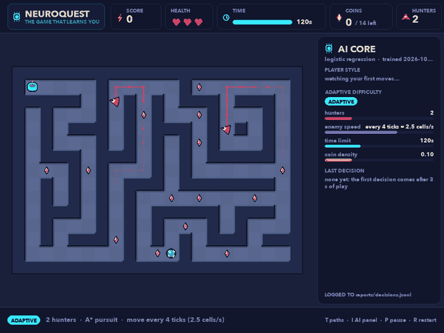
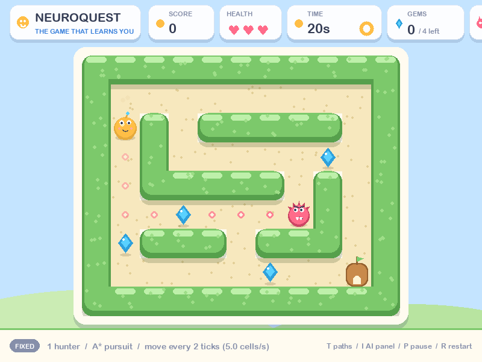

# NeuroQuest — The Game That Learns You

A maze survival game (Python + Pygame) built as an AI/ML capstone. Hunters navigate with A* search, a scikit-learn classifier predicts the player's style from gameplay data, a transparent controller adapts the difficulty and records its reasons, a tabular Q-learning agent learns to play a small board from the rules alone, and a dashboard explains every prediction, decision and the agent's learning. All results are measured, seeded and reproducible; nothing is hard-coded to look smart.

<p>


</p>

**AI dashboard:** `neuroquest/reports/dashboard.html` (the path from the parent of a clone, and the path on GitHub Pages; [open it](reports/dashboard.html)). One self-contained HTML file with the figures embedded; rebuild with `neuroquest dashboard`.

## What is inside

| Feature | How it works | Measured result |
|---|---|---|
| Enemy pathfinding | A* on the maze graph with the Manhattan heuristic, recomputed every move; a random-walk baseline for comparison | Path length equal to BFS on 200/200 seeded mazes with fewer expansions; the A* hunter reached a still player in 100/100 episodes in exactly the path length, the random walker in 1/100 |
| Player-style classifier | 14 rate features from the event log, computable on any prefix of play; logistic regression chosen by grouped cross-validation over random forest, KNN, a majority baseline, a hand-written rule labeller and a one-feature tree; evaluated once on 24 held-out maze seeds | Test accuracy 0.934, macro-F1 0.933 (majority 0.167, rules 0.545); usable from 25 % of an episode (0.917) |
| Adaptive difficulty | A rule table (ease on heavy damage or when behind on time; tighten when cruising after an encounter; otherwise hold) choosing one lever by the predicted style; every change is one step inside fixed bounds; every decision logged with inputs, rule and a reason | 1,000 random decisions never leave the bounds; fixed vs adaptive on 40 seeded episodes per profile: differences within noise, stated as such |
| Q-learning agent | A gym-style environment over the same `step()`; tabular Q-learning with ε-greedy exploration on an 11×9 board with one A* hunter | 100/100 held-out wins, return +7.32, 0.04 hits per episode; the hunter-blind collector is hit in 82/100; no transfer to another board (0/100) |
| Explainability | In-game panel (probabilities, knobs, the last decision and its reason) and an offline dashboard built from the recorded files only | 8 sections, 11 figures, confident mistakes shown with their features |
| Tests | Unit, integration, real-loop scenarios, edge cases, regressions, CLI | 377 passed, 99.1 % line coverage, headless |

## Quick start

Requires Python 3.12 or newer (this project used the python.org 3.13 build; the Homebrew 3.14 is externally managed).

```bash
git clone git@github.com:Reetika-k/neuroquest.git   # or https://github.com/Reetika-k/neuroquest.git
cd neuroquest
python3.13 -m venv .venv
.venv/bin/pip install -e ".[dev]"      # installs the package in editable mode plus pytest and coverage
.venv/bin/python -m neuroquest check   # headless smoke test: prints versions, exits 0
.venv/bin/python -m neuroquest play    # the game
.venv/bin/pytest                       # test suite: 377 tests, ~50 s, no display needed
.venv/bin/coverage run --source=src/neuroquest -m pytest && .venv/bin/coverage report -m   # 99.1 % line coverage
```

Exact versions that were installed and tested are frozen in `requirements.txt` (`pip install -r requirements.txt` reproduces them). A clone already contains the processed dataset, the trained models and the reports; only the raw episode logs are regenerable and git-ignored.

## Commands

| Command | Purpose | Phase |
|---|---|---|
| `python -m neuroquest --version` | print the version | 3 |
| `python -m neuroquest check` | environment smoke test | 3 |
| `python -m neuroquest play [--seed N] [--time-limit S] [--enemies N] [--enemy-interval K] [--enemy-kind astar\|random] [--fixed] [--no-log] [--no-panel] [--no-menu]` | play the game | 4–8 |
| `python -m neuroquest play --agent` | watch the trained Q-learning agent play its board | 9b |
| `python -m neuroquest benchmark-enemies [--episodes 100] [--mazes 200]` | A* chaser vs random walker; A* vs BFS; writes `reports/*.csv` | 5 |
| `python -m neuroquest simulate [--episodes 120] [--seed 0]` | scripted player profiles play headlessly → `data/raw/*.jsonl` | 6 |
| `python -m neuroquest build-dataset` | logs → `data/processed/episodes.csv` + `data/schema/features.schema.json`, prints an inspection summary | 6 |
| `python -m neuroquest train [--seed 42]` | seed-grouped split, baselines + LR/RF/KNN with grouped CV, test metrics, ablation; saves `models/behaviour_clf.joblib` + meta, `reports/metrics.json` | 7 |
| `python -m neuroquest ab-test [--episodes 40] [--seed 500]` | fixed vs adaptive difficulty on the simulated profiles → `reports/ab_results.csv` + summary | 8 |
| `python -m neuroquest dashboard [--out FILE] [--figures-dir DIR]` | explainability report: `reports/dashboard.html` + `reports/figures/dash_*.png` from the recorded data | 9 |
| `python -m neuroquest rl-train [--episodes 20000] [--seed 0]` | Q-learning agent on the RL board vs random, A*-to-exit, greedy-collector and cautious baselines → `models/q_table.npz`, `reports/rl_*.{csv,json}` | 9b |

`play` loads the saved model, shows the predicted play style in the footer after 3 s, runs the adaptive difficulty controller (`--fixed` to disable; decisions go to `reports/decisions.jsonl`), and saves every human episode to `data/raw/human-*.jsonl` (`--no-log` to disable). With `--agent` the trained policy chooses the moves on its 11×9 training board (fixed difficulty, no logging; R restarts with a new hunter start).

## Controls

Arrow keys or WASD move the cyan explorer drone one cell per tick while held. Collect the amber crystals and reach the green portal before the clock runs out; the crimson hunters cost a heart on contact. **T** toggles AI vision (the hunters' planned A* paths), **I** toggles the AI intelligence panel (style probabilities, difficulty knobs, the last decision and its recorded reason), P pauses and lists the controls, R restarts with a new maze, F12 saves a screenshot, Esc quits. Mechanics: `docs/04_mvp.md`; interface: `docs/UI_DESIGN.md`.

## Documentation

| Document | Content |
|---|---|
| [`docs/CAPSTONE_DOCUMENTATION.md`](docs/CAPSTONE_DOCUMENTATION.md) | The final report: overview, problem, architecture, AI/ML methodology, dataset, prompts and iterations, testing, limitations, setup, demo |
| [`docs/DEMO_SCRIPT.md`](docs/DEMO_SCRIPT.md) | An 8-minute demonstration, step by step, with what to say |
| [`docs/DEPLOYMENT.md`](docs/DEPLOYMENT.md) | Publishing the repository and hosting the dashboard on GitHub Pages; running from a clone |
| [`docs/PROMPT_ENGINEERING.md`](docs/PROMPT_ENGINEERING.md) | The prompts given, what worked and what did not, the coding iterations that mattered |
| [`docs/DEVELOPMENT_LOG.md`](docs/DEVELOPMENT_LOG.md) | 16 eight-part entries: problem, prompt, output, what failed, limitation, revision, tests, improvement |
| [`reports/test_report.md`](reports/test_report.md) | Every test case with expected result, actual result, status and improvement; coverage; timings |
| `docs/00`–`10` | The brief and one document per phase: requirements, architecture, MVP, enemies, dataset, ML evaluation, adaptation, explainability, RL agent, testing |
| `docs/UI_DESIGN.md` | The design system and screens |

## Layout

`src/neuroquest/core` is the pure game logic (no Pygame); `ai` holds A*, BFS and the enemy policies; `ui` is the only package that imports Pygame; `data` → `ml` → `adapt` → `dashboard` is the AI/ML pipeline; `sim` runs scripted players headlessly; `rl` wraps the core in a gym-style environment for the Q-learning agent. Details: `docs/02_architecture.md`.

## Honesty notes

The classifier recognises *simulated* personalities; human play is logged in the same format and kept separate until labelled. The controller is shown to be safe and traceable, not to improve outcomes. The agent learns one board and does not transfer. Every number above comes from a recorded run that the commands reproduce.
