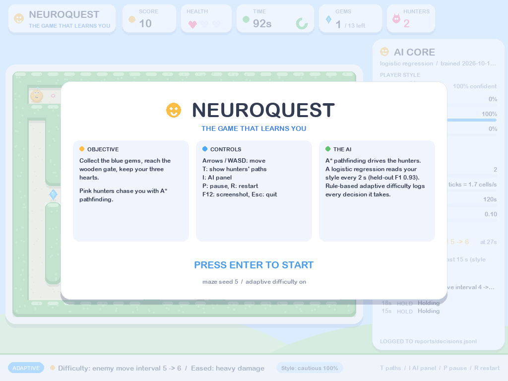
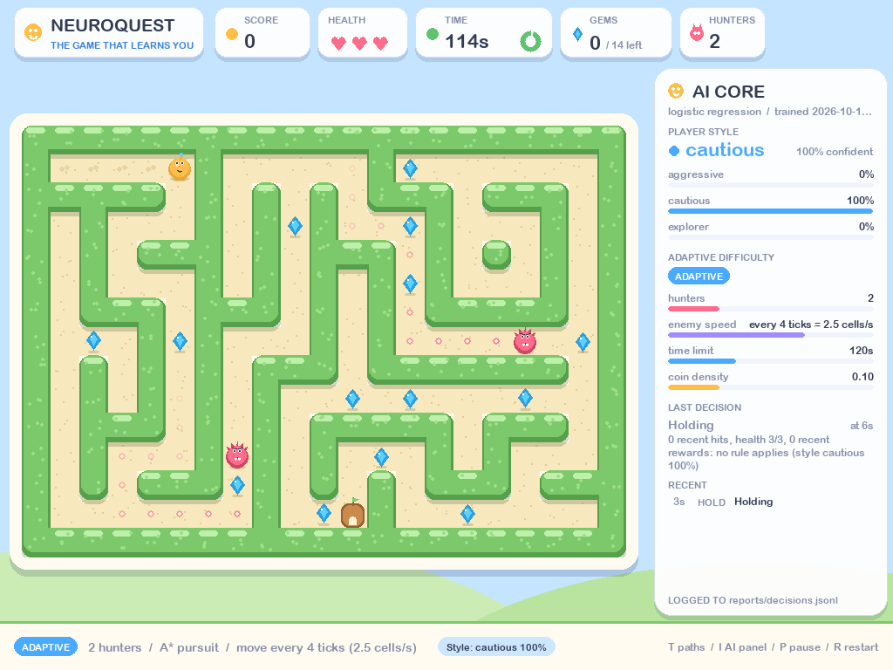
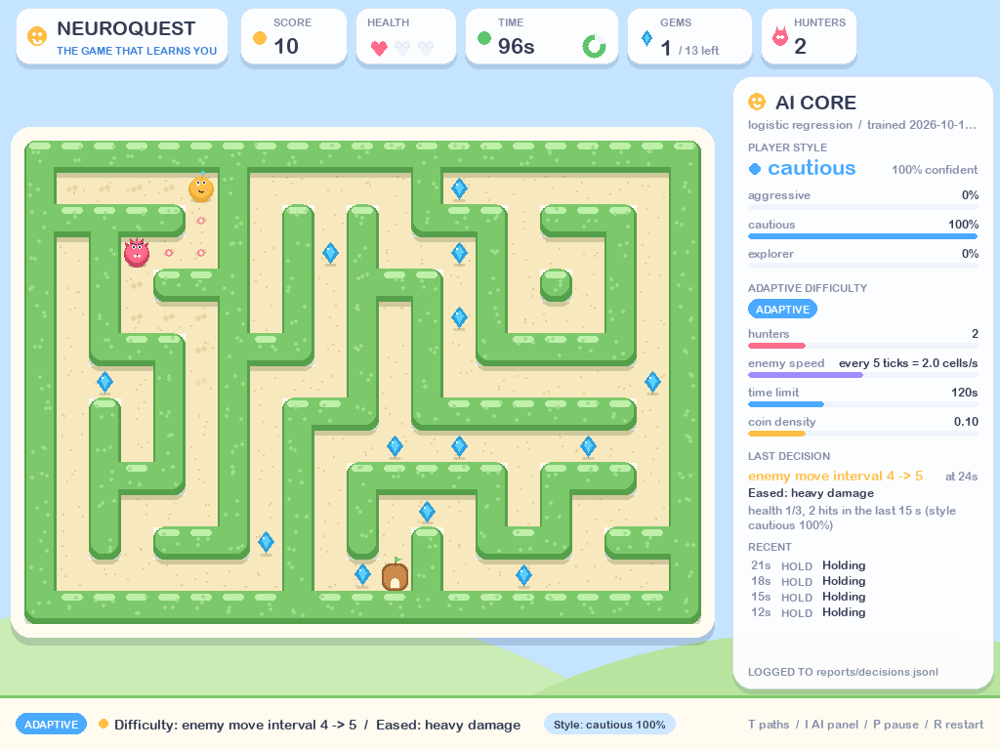
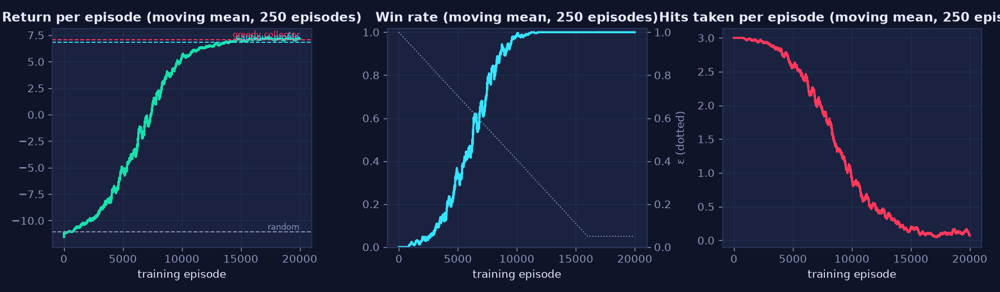
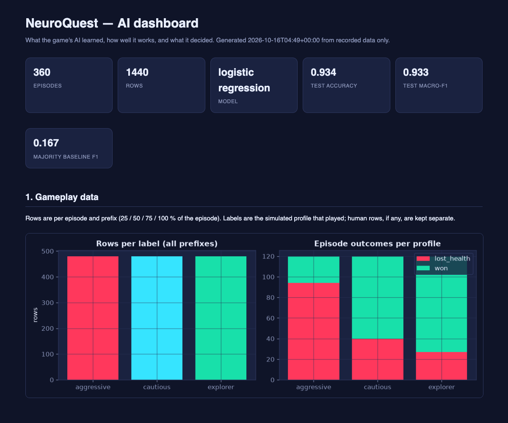

# NeuroQuest — The Game That Learns You: Capstone Report

Status: **final, approved by the learner 2026-10-15** · Date: 2026-10-15 · Repository folder: `neuroquest/` · AI dashboard: `neuroquest/reports/dashboard.html` (self-contained HTML; [open it](../reports/dashboard.html))

## 1. Cover page

| | |
|---|---|
| **Learner name** | Reetika Kukreja |
| **Email id** | reetikakukreja12@gmail.com |
| **Mobile number** | 9694228896 |
| **Project title** | NeuroQuest — The Game That Learns You |
| **Type** | Self-directed AI/ML capstone: a Python/Pygame maze survival game with search-based enemies, a supervised player-style classifier, bounded adaptive difficulty, a reinforcement-learning agent and an explainability dashboard |
| **Development window** | 2026-10-10 to 2026-10-15, eleven approved phases |
| **Coding assistant** | AI coding assistant, directed through the phase-gated workflow in `docs/00_project_brief.md` |
| **AI dashboard** | https://reetika-k.github.io/neuroquest/reports/dashboard.html |
| **Project page** | https://reetika-k.github.io/neuroquest/ (a desktop Python game: it runs from a clone, see section 15) |
| **Repository** | https://github.com/Reetika-k/neuroquest |

## 2. Project overview

NeuroQuest is a 2D maze survival game. The player moves through a seeded maze, collects crystals, avoids hunters and reaches the portal before the clock runs out. The game's intelligence is real and measured:

- hunters plan their chase with **A\*** search on the maze graph;
- a **scikit-learn classifier** reads the player's style (aggressive, cautious, explorer) from features computed on the game's own event log, live, from three seconds into an episode;
- a **rule-based adaptive controller** eases or tightens one difficulty knob at a time, inside fixed bounds, and records the rule, the inputs and a plain-language reason for every decision;
- a **tabular Q-learning agent** learns to play a small board from the rules alone and is compared with random and scripted baselines on held-out episodes;
- a **next-move model** predicts the player's next action from what the game shows, evaluated on later episodes against naive and hand-written baselines, and drives an optional anticipating hunter whose measured effect is nil and reported as such;
- an **explainability dashboard** and an in-game intelligence panel show every prediction, decision and evaluation result, including the model's confident mistakes.

The project's point is to demonstrate AI/ML that is honest: every number is produced by a seeded, reproducible run; nothing is hard-coded to look smart; limitations are stated next to results.

## 3. Problem statement

Games that claim to "adapt to the player" usually hide a few thresholds behind the phrase. The problem this project set itself was to build a small game in which each AI claim can be checked: that the enemies' paths are optimal, that the style prediction comes from a model evaluated on data it never saw, that difficulty changes are bounded and traceable, that an agent *learned* rather than was scripted, and that a reviewer can inspect how any decision was reached. A second, equal problem was process: to build it in eleven phases with an approval gate after each, to log every step with what failed as well as what worked, and never to report a test or a metric that was not produced by an executed run.

## 4. Target users

- **The player**, who wants a short, readable game: clear win and loss conditions, visible enemies, and an AI panel they can open or ignore.
- **A capstone reviewer**, who needs to verify claims: tests, metrics, logs, a dashboard, and documents that say what was not achieved.
- **The learner**, who needs to understand and present every component, which is why each phase document explains its concepts in plain language before its results.

## 5. Proposed solution and key features

| Feature | What it does | Where |
|---|---|---|
| Seeded maze game | Recursive-backtracker mazes with optional braiding; one cell per tick; 10 logic ticks per second; rendering at 60 FPS | `core/maze.py`, `core/rules.py`, `ui/` |
| A\* hunters | Shortest path to the player recomputed every move; a random-walk baseline for comparison | `ai/astar.py`, `ai/policies.py` |
| Event log and features | Every tick's events are logged; 14 rate features are derived from the log on any prefix, so prediction can run mid-episode | `data/` |
| Player-style classifier | Logistic regression selected by grouped cross-validation over random forest, KNN and three baselines; live prediction in the footer and panel | `ml/`, `ui/app.py` |
| Adaptive difficulty | Seven rules, four bounded knobs, one step per decision, every decision logged with its reason; fixed-vs-adaptive A/B harness | `adapt/`, `sim/ab.py` |
| Q-learning agent | Gym-style environment over the same rules; ε-greedy tabular Q-learning; five-agent comparison; `play --agent` to watch it | `rl/` |
| Next-move model | Rows replayed from the logs through the rules; temporal split; majority, repeat-last and greedy baselines vs logistic regression and random forest; an anticipating hunter and a pursuit benchmark | `ml/next_move.py`, `ai/policies.py`, `ai/benchmark.py` |
| Explainability | In-game panel (I key), AI vision (T key), and a self-contained dashboard built from recorded files only | `ui/panel.py`, `dashboard/` |
| Honest process | Phase gates, an A–I report per step, a 16-entry development log, a test report with expected and actual results | `docs/` |

## 6. System architecture

The system is built around one pure function, `rules.step(state, action, params)`, that advances the game by one tick without drawing anything. Everything else consumes it: the Pygame window plays it, the simulation harness runs it headlessly with scripted players, the RL environment wraps it, and the tests call it directly. Game logic (`core`) never imports Pygame; `ui` is the only package that does.

```
inputs: keyboard · scripted profiles (sim) · RL agent (rl)
          │
          ▼
core: Maze · GameState · rules.step()  ──── enemies ask ai.astar / ai.bfs / random
          │ events                                 │ state
          ▼                                        ▼
data.events (JSONL per episode)              ui.render + ui.panel (Pygame, 60 FPS)
          │
          ▼ prefix-computable features
data.features ──▶ data/processed/episodes.csv ──▶ ml.train (LR · RF · KNN · baselines) ──▶ models/ + reports/metrics.json
          │ live features                                                        │
          ▼                                                                      ▼
ml.predict (label + probabilities) ──▶ adapt.controller (rules → bounded params → decisions.jsonl) ──▶ back into core
          │
          ▼
dashboard (episodes.csv, metrics.json, decisions.jsonl, ab_results.csv, rl_*.{csv,json}) ──▶ reports/dashboard.html
```

Design decisions that mattered: a fixed logic tick makes human and simulated episodes identical in rules and timing; events are the source of truth and features are derived from them, so the dataset can be rebuilt when feature definitions change; difficulty knobs are integers or bounded floats, so a change is one step inside published bounds; every artefact is written to a file a later stage reads, so the dashboard shows recorded data, never a live estimate. Full detail: `docs/02_architecture.md`.

**Packages.** `core` (maze, state, rules) · `ai` (A\*, BFS, policies, benchmark) · `data` (events, features, schema, labels, dataset) · `sim` (profiles, harness, A/B) · `ml` (split, train, evaluate, predict) · `adapt` (bounds, controller) · `rl` (env, qlearning, agents, pipeline) · `dashboard` (figures, report) · `ui` (theme, render, panel, input, app) · `cli`.

## 7. AI/ML methodology

### 7.1 Search: A\* enemies (Phase 5)

The maze is a graph: open cells are nodes, orthogonal adjacency is an edge of cost 1. A\* orders its frontier by `g + h` where `h` is the Manhattan distance, which never overestimates on this grid (admissible), so the first time the goal is removed from the frontier the path is shortest. A breadth-first search is kept as the reference. Hunters recompute the path every move (0.285 ms on the 21×15 board), so their path is always current.

| Check | Result |
|---|---|
| A\* vs BFS path length on 200 seeded mazes | equal on 200/200; A\* expanded 58.2 cells on average vs 73.8 (−21 %) |
| A\* hunter vs a motionless player, 100 seeded mazes | caught 100/100 in exactly the shortest-path length (1.00 ticks per cell); random walker 1/100 |

### 7.2 Supervised learning: the player-style classifier (Phases 6–7)

**Data.** Three scripted player profiles (aggressive, cautious, explorer), each sampling its parameters per episode so the classes overlap, played 120 seeded mazes each at the default difficulty: 360 episodes, 1,440 rows (one per episode and prefix 25/50/75/100 %). The label is the profile that played, ground truth by construction. Human play is logged in the same format, labelled `rule:<class>` by a documented rule labeller, and kept separate because that labeller is circular (section 8).

**Features.** Fourteen rates and ratios computable on any prefix: elapsed time, moves, bumps, idling, new cells, distinct cells, revisits, rewards per tick and share, damage per tick, time near an enemy, approach ratio, progress to the exit, closest approach to the exit. `prefix_ratio` was removed as a feature when inspection showed a live game cannot know it.

**Protocol.** Split by maze seed (96 training seeds, 24 test seeds), so prefixes of one episode never straddle the split; candidates ranked by 5-fold grouped cross-validation on the training rows; the test rows used once, afterwards, for every model.

| Model | CV macro-F1 (train) | Test accuracy | Test macro-F1 |
|---|---|---|---|
| Majority class | 0.167 | 0.333 | 0.167 |
| Rule labeller (hand-written thresholds) | – | 0.535 | 0.545 |
| Single-feature tree (`approach_ratio`) | 0.602 | 0.622 | 0.618 |
| k-nearest neighbours (k = 15) | 0.886 ± 0.023 | 0.903 | 0.902 |
| Random forest (300 trees) | 0.904 ± 0.012 | 0.924 | 0.924 |
| **Logistic regression (selected)** | **0.906 ± 0.015** | **0.934** | **0.933** |

Per class (logistic regression, 96 test rows each): aggressive precision 0.89 / recall 0.99; cautious 0.96 / 0.97; explorer 0.96 / 0.84. Accuracy by prefix: 0.917 at 25 %, 0.931, 0.931, 0.958 at 100 %. Ablation without `elapsed_s`: 0.940 macro-F1, so play time is not a shortcut. Logistic regression and the forest are tied within the CV spread; the linear model was chosen for its readable coefficients and speed in the game loop. The re-run in Phase 10 reproduced every number.

**Interpretation.** Permutation importance: near-enemy ratio 0.231, damage per tick 0.156, idle ratio 0.139, new cells per tick 0.129. Coefficients read as the profiles were designed: aggressive players get hit and never stop; cautious players stay away and wait; explorers get close without being hit while covering the maze.

**Errors.** 19 of 288 test rows are wrong, 11 of them explorers read as aggressive early in quiet episodes: before meeting an enemy, an explorer sprinting through new cells is indistinguishable from an aggressive player, and the model is confidently wrong there. This is shown on the dashboard with the rows' features.

### 7.3 Decision system: adaptive difficulty (Phase 8)

Every 3 s the controller takes a snapshot (health, recent hits, recent rewards, time near enemies, time since the last change, time left, progress, predicted style and confidence) and applies a rule table, first match wins: ease on heavy damage (R1) or when behind on time (R2); hold during warm-up, before any encounter, or during a cooldown; tighten when cruising after an encounter (R3); otherwise hold. The lever depends on the predicted style when confidence is ≥ 60 % (aggressive → enemy count; cautious → enemy speed; explorer → time limit). Each change is one step of one knob, clamped to bounds (enemies 1–5, move interval 2–8 ticks, reward density 0.05–0.25, time 60–240 s), and recorded with inputs, rule, before, after and a reason.

Fixed vs adaptive, 40 seeded episodes per profile and condition (`reports/ab_results.csv`):

| Profile | Win rate fixed → adaptive | Median ticks | Mean hits |
|---|---|---|---|
| aggressive | 0.200 → 0.225 | 99 → 100 | 2.80 → 2.78 |
| cautious | 0.625 → 0.650 | 367 → 366 | 1.98 → 1.98 |
| explorer | 0.800 → 0.850 | 269 → 271 | 1.58 → 1.53 |

With 40 episodes per cell the noise on a win-rate difference is about ±20 points, so these differences are not evidence of improvement. What the experiment shows is that the controller is safe (no profile worse off, no time-outs) and traceable. Its first version tightened within 5 s of play, before any encounter, and cut explorers' win rate from 80 % to 60 %; that failure produced the warm-up, encounter and cooldown holds of the version shipped. A second bug found by the experiment, rewards being refunded on any parameter change, was fixed before the results were trusted.

### 7.4 Reinforcement learning: the Q-learning agent (Phase 9b)

**Environment.** A gym-style wrapper over the same `step()`: one fixed 11×9 fully braided board (43 open cells, 4 crystals, one A\* hunter moving every 2 ticks, 200 ticks of time). Observation: the agent's cell, one bit per remaining crystal, and the hunter's exact offset within ±2 cells or only its direction beyond; no clock, health or walls. Actions: the game's five. Reward per tick: −0.01, +1 per crystal, +5 at the portal, −2 per hit, −5 more at zero health. Reaching the portal or dying terminates; running out of time truncates.

**Learning.** Tabular Q-learning, α 0.2, γ 0.95, ε linear 1.0 → 0.05 over 16,000 of 20,000 episodes; 1,753 observations visited; 12 s. The moving win rate first reaches 0.5 at episode 6,241 and 0.95 at 9,509; hits per episode fall from 3.0 to 0.11.

**Evaluation on 100 held-out seeds** (20 distinct hunter starts, since the hunter is deterministic):

| Agent | Win rate [95 % CI] | Mean return | Crystals | Hits |
|---|---|---|---|---|
| random | 0.00 [0.00, 0.04] | −11.05 | 0.45 | 3.00 |
| A\* to exit | 1.00 [0.96, 1.00] | +6.08 | 2.00 | 0.39 |
| greedy collector | 1.00 [0.96, 1.00] | +7.10 | 4.00 | 0.82 |
| cautious profile | 1.00 [0.96, 1.00] | +6.85 | 2.17 | 0.00 |
| **Q-learning** | **1.00 [0.96, 1.00]** | **+7.32** | 2.59 | 0.04 |

The agent learned to give up the two crystals on the hunter's side of the board for safety, and reached the highest return; a second training seed reproduced it. On a board it never saw it wins nothing: a tabular agent memorises one board. The first board tried, with the game's default braiding, was a single corridor where every agent took exactly one hit; the board was chosen by measuring 36 layouts for a hazard that is both real and avoidable. On another layout the discounted optimum really was to take the hit; that counter-example is kept in `docs/09b_rl.md`.

### 7.5 Predictive model: the player's next move (Phase 7b, extension)

A second supervised model predicts the player's next action (up, down, left, right, stay) from what the game shows at that tick: the last three actions, which neighbouring cells are open or already visited, the direction and distance of the nearest crystal, the portal and the nearest hunter, the shortest-path direction to the nearest crystal and to the portal, crystals left and health (43 features). Rows are built by replaying every simulated episode log through the real rules (360 episodes, 86,726 ticks, 0 replay mismatches); the target is self-labelled, so human play could train this model directly once there is enough of it.

**Temporal split.** Episodes are ordered by seed, the order they were generated: seeds 0–95 train (69,976 rows), seeds 96–119 test (16,750 rows). The model was chosen on the last 20 % of the training episodes (15,206 rows), never on the test rows.

| Model | Test accuracy | Test macro-F1 | aggressive | cautious | explorer |
|---|---|---|---|---|---|
| Majority ("stay") | 0.315 | 0.096 | 0.09 | 0.43 | 0.27 |
| Repeat the last move | 0.662 | 0.629 | 0.54 | 0.71 | 0.65 |
| Greedy rule (shortest path to the nearest crystal, else the portal) | 0.510 | 0.484 | **0.79** | 0.41 | 0.52 |
| Logistic regression | 0.829 | 0.822 | 0.76 | 0.84 | 0.84 |
| **Random forest (selected)** | **0.853** | **0.846** | 0.78 | **0.86** | **0.88** |

The forest beats the strongest baseline by 0.22 macro-F1 and every class is predicted with F1 between 0.82 and 0.89. It is bounded to 120 trees of depth 12 (7.5 MB compressed) because an unbounded forest pickled to 216 MB; the bound cost 0.007 validation macro-F1 and was chosen on the validation tail. Its gain is on cautious and explorer players, whose moves depend on the hunters and on which cells they have seen; for aggressive players, who walk the shortest path to crystals by construction, the hand-written greedy rule is one point better, which is reported as such. The most informative feature is whether the player stayed still on the previous tick (cautious players wait in runs), then which neighbours are open. The model also drives an optional *anticipator* hunter that heads for the player's predicted next cell instead of their current one. Measured against plain A* hunters on 40 seeded episodes per player profile, it made no difference: catch rates within one episode per cell, the same number of hits in 103 of 120 paired episodes, a mean difference of −0.04 hits. The hunters move once every four ticks, so aiming one step ahead rarely changes their next step. A good predictor is not automatically a better hunter, and the result is recorded as such (`docs/07b_next_move.md`).

### 7.6 Explainability (Phase 9)

The in-game panel shows the three class probabilities, the model's metadata, the difficulty knobs against their bounds, the last decision with its recorded reason and the recent decisions. The dashboard (`neuroquest/reports/dashboard.html`) has nine sections built from recorded files only: data, model evaluation, what the model looks at, correct and incorrect predictions with their features, a session as the model saw it, adaptive decisions with rule markers, fixed vs adaptive, the RL agent, and the next-move model with the pursuit benchmark; a missing input makes its section say so.

## 8. Dataset description

| Item | Value |
|---|---|
| Source | 360 simulated episodes (3 profiles × 120 seeds, identical mazes across profiles), default difficulty, 21×15 boards; plus human episodes from the window (`human-*.jsonl`, kept separate) |
| Raw form | One JSONL file per episode: a metadata line, then one line per event (`t, type, pos, detail`) |
| Processed form | `data/processed/episodes.csv`: 1,440 rows × (8 metadata columns + 14 features); schema `data/schema/features.schema.json`; 0 invalid rows |
| Labels | Synthetic: the generating profile (480 rows each, balanced). Human: `rule:<class>` from documented thresholds, reported separately; the rule labeller agrees with the true profile in only 60 % of simulated episodes, which is the stated reason it is a baseline, not a training label |
| Outcomes | aggressive 26 won / 94 lost; cautious 80 / 40; explorer 93 / 27 (median lengths 10 s, 33 s, 26 s) |
| Most separable features | damage per tick, idle ratio, moves per tick, new cells per tick |
| Reproducibility | regenerating with the same seeds yields byte-identical logs and CSV (tested); the training run is seeded and reproduces `reports/metrics.json` exactly |

Full inspection: `docs/06_dataset.md`.

## 9. Prompt engineering log and AI-assisted coding iterations

The learner directed the assistant with one complete brief, then with short approvals at each gate and specific feedback where something was wrong. The prompts in order, what each produced, what worked (a brief with gates and honesty rules; one-word approvals; feedback with evidence) and what did not (vague aesthetic prompts led to two rejected redesigns until two multiple-choice questions replaced guessing) are in `docs/PROMPT_ENGINEERING.md`. The twelve coding iterations that mattered, from wrong test fixtures to the single-corridor RL board and a deletion the suite reverted, are tabled there with how each was verified. The primary record is `docs/DEVELOPMENT_LOG.md`: 16 entries, each with the problem, the prompt, the output, what worked and failed, the limitation, the revision, the tests and the improvement.

## 10. Testing and improvement report

388 tests pass in three to five minutes with 99.1 % line coverage (377 in 50.9 s at the Phase 10 run; the Phase 7b tests train small forests; the figure was re-confirmed after the cartoon-world interface of entry 13), all headless: unit tests per module, integration tests with the real saved model (play → log → dataset → prediction → decisions; dashboard from the repository data; byte-level reproducibility), ten gameplay scenarios that drive the real window loop with a scripted player and injected keys (win, both losses, restart, pause, keys, quit, window close, menu, a live difficulty change), fourteen edge cases, one regression test per fixed bug, and every CLI command. The suite found and fixed two robustness problems in Phase 10 (a font cache that died on re-initialisation; word-wrap that let an overlong token spill out of the panel) and reverted one wrong deletion. The report with test case, expected result, actual result, status and improvement is `reports/test_report.md`; the plan and requirement traceability are in `docs/10_testing.md`.

## 11. Working prototype and results at a glance

| Claim | Evidence |
|---|---|
| Playable game with win and both losses, restart, pause, panel, AI vision | `neuroquest play`; scenario tests; screenshots in `docs/screenshots/` |
| Optimal enemy paths | 200/200 equal to BFS; 100/100 catches in exactly the path length |
| Classifier beats the baselines by ≥ 0.20 macro-F1 (S4) | 0.933 vs 0.167 (+0.77); vs rules 0.545 |
| Live predictions from the saved model, not hard-coded (S5) | replay of the saved model equals the live prediction (integration test) |
| Bounded, fully logged adaptation (S6) | 1,000 random decisions in bounds; every decision carries inputs, rule and reason |
| Fixed vs adaptive compared with no claims beyond the numbers (S7) | table in 7.3, "within noise" stated |
| RL agent vs random on 100 held-out episodes with a learning curve (S12) | table in 7.4; `reports/rl_curve.csv`; dashboard section 8 |
| Next-move model with a temporal split against majority and repeat-last baselines (S11) | table in 7.5: 0.846 macro-F1 vs 0.629 and 0.096; `reports/next_move_metrics.json`; dashboard section 9 |
| ≥ 40 tests, all executed, in a report (S9) | 388; `reports/test_report.md` |
| Every Phase 11 document exists; the prompt log records real iterations only (S10) | this document set |

Screenshots and animations: `docs/screenshots/neuroquest-play.gif` (the cautious profile on the default board, panel and AI vision open, two difficulty changes), `docs/screenshots/neuroquest-agent.gif` (the agent), `phase9-dashboard.png`, `phase9b-*.png`, `ui5-*.png` (the cartoon-world interface of entry 13; `ui4-*.png` show the earlier bright-arcade look).


*Start screen: objective, controls and what the AI does.*


*Playing with the AI panel open: the classifier reads the player as cautious (100 %), the adaptive-difficulty settings, and the last decision with its reason.*


*The controller eases the game after heavy damage (enemy move interval 4 → 5) and logs the inputs, rule and reason.*


*The Q-learning agent learning from the rules alone: return, win rate and hits taken per episode over 20,000 training episodes.*


*The live AI dashboard: the headline numbers and the gameplay data; further down it compares the model with its baselines and shows the confusion matrix, the decisions and the agent.*

## 12. Tools and technologies

| Tool | Version | Use |
|---|---|---|
| Python | 3.13.7 (python.org build) | runtime; the Homebrew 3.14 is externally managed |
| pygame-ce | 2.5.8 | window, drawing, input |
| numpy, pandas | 2.5.3, 2.3.3 | arrays, dataset build, CSV |
| scikit-learn | 1.9.1 | models, grouped splits, metrics, permutation importance |
| matplotlib | 3.11.2 | dashboard figures (Agg backend) |
| pytest, coverage | 8.4.2, 7.16.2 | tests, line coverage |
| AI coding assistant | — | coding assistant under the phase-gated brief |

No image or audio assets; no cloud services, databases or paid APIs.

## 13. Challenges and solutions

| Challenge | What happened | Resolution |
|---|---|---|
| Honest labels for "play style" | Human labels would be self-reported and unavailable at scale; a rule labeller is circular | Profile-generated labels for training; the rule labeller reported as a baseline (0.545) and used only for human rows, kept separate |
| A feature that leaks | `prefix_ratio` was in the feature list but cannot be known live | Removed from features during inspection; a regression test pins it |
| An adaptation that hurt | v1 tightened within 5 s; explorers fell from 80 % to 60 % wins; rewards were refunded on parameter changes | v2 with warm-up, encounter and cooldown holds; reconcile fixed; experiment re-run |
| The learner disliked the look, twice | Two redesigns from vague prompts were rejected | Two multiple-choice questions, then one accepted pass ("bright arcade") |
| An RL board that could not be learned | Every agent took exactly one hit on a single-corridor maze | A measured scan of 36 layouts; a braided board where the hazard is real and avoidable |
| Coverage misread as dead code | A bar option deleted; five tests failed | Restored; a test renders the last ten seconds; lesson recorded |

## 14. Limitations and future enhancements

**Limitations.** The classifier recognises simulated personalities; its accuracy on humans is unknown until labelled human data exists. Its probabilities are not calibrated, and early in a quiet episode explorer and aggressive are indistinguishable. The controller is safe and traceable, not shown to improve outcomes; equalising outcomes across styles would need stronger or earlier easing for aggressive players, who die within about 10 s. The agent learns one small board under partial observation and does not transfer; the hunter is deterministic, so 100 evaluation seeds are 20 situations. No test opens a real window. The game is desktop-only.

**Future enhancements.** Self-reported labels from play-testers and a human-vs-simulated accuracy measurement; probability calibration; training the next-move model on human play (its target is self-labelled, so only volume is missing); a learned adaptation policy compared with the rule table in simulation; function approximation for the agent so it can generalise across boards; a browser build of the game-only part with pygbag; sound and sprite art.

## 15. Setup and execution

```bash
cd neuroquest
python3.13 -m venv .venv                      # Python 3.12 or newer
.venv/bin/pip install -e ".[dev]"
.venv/bin/python -m neuroquest check          # headless smoke test
.venv/bin/python -m neuroquest play           # the game (T: AI vision, I: panel, P, R, F12, Esc)
.venv/bin/python -m neuroquest play --agent   # the Q-learning agent on its board
.venv/bin/pytest                              # 377 tests, ~50 s
open reports/dashboard.html                   # the dashboard
```

A clone contains the processed dataset, the trained models and every report; the raw episode logs are regenerable (`simulate` → `build-dataset` → `train` → `ab-test` → `rl-train` → `dashboard`, about two minutes in total). Windows users run `.venv\Scripts\python` instead. Exact tested versions: `requirements.txt`.

## 16. Demonstration and delivery

- Demonstration script (about 8 minutes, with what to say and what to expect): `docs/DEMO_SCRIPT.md`.
- AI dashboard (live): https://reetika-k.github.io/neuroquest/reports/dashboard.html · project page: https://reetika-k.github.io/neuroquest/ · repository: https://github.com/Reetika-k/neuroquest. Hosting steps: `docs/DEPLOYMENT.md`.
- Final README: `neuroquest/README.md`; repository README: `../README.md`.

## 17. Final outcome

A playable game whose AI components are each backed by a measured result, a reproducible pipeline from play to prediction to decision, two supervised models evaluated on data generated after their training data, an agent that learned from the rules alone, a dashboard that shows the evidence including the failures and one negative result, 388 executed tests, and a development record in which the mistakes are written down next to the fixes.
